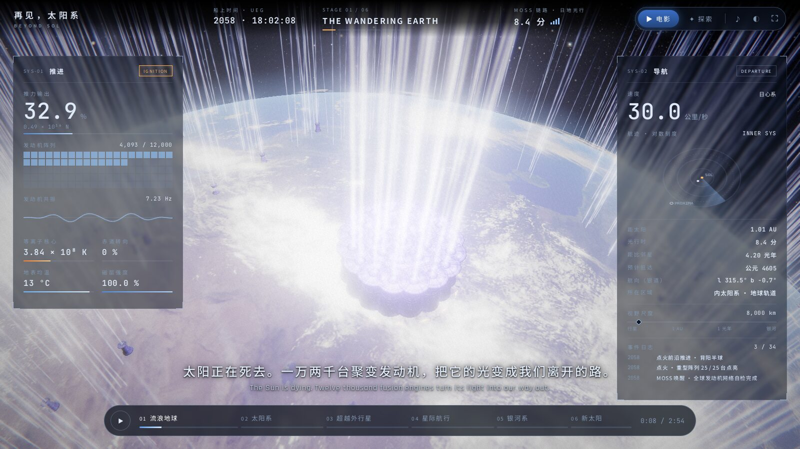
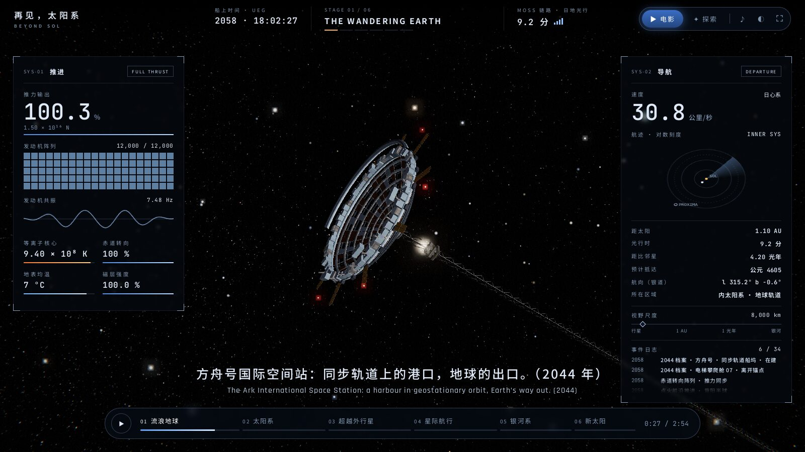
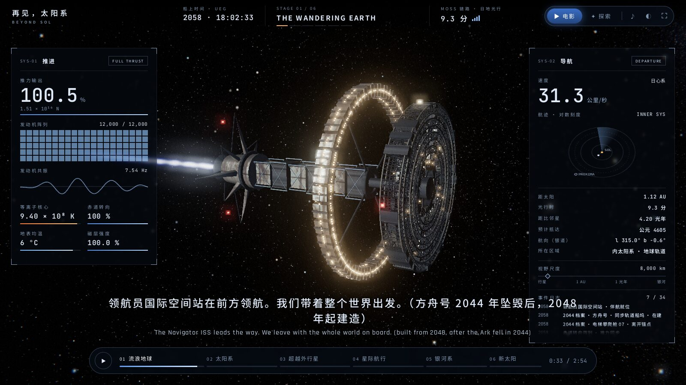
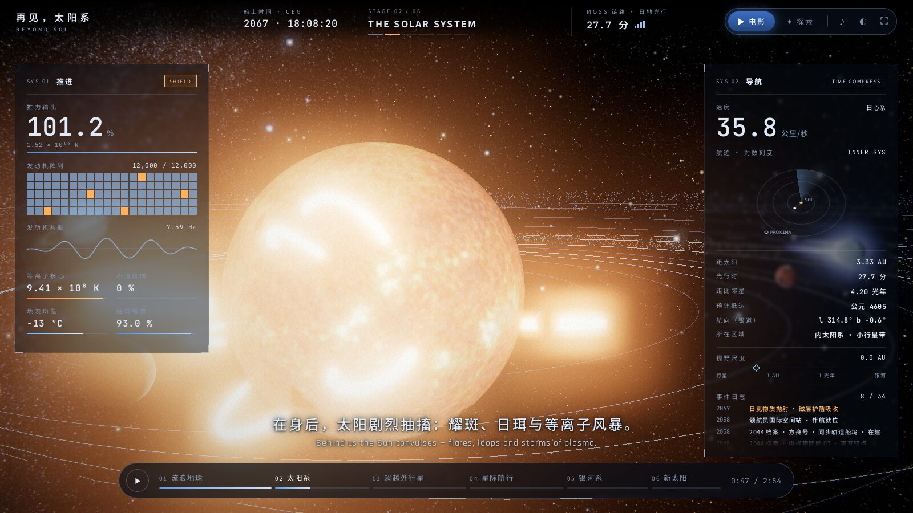
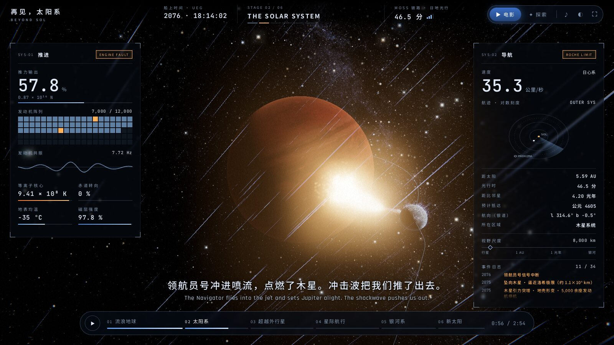
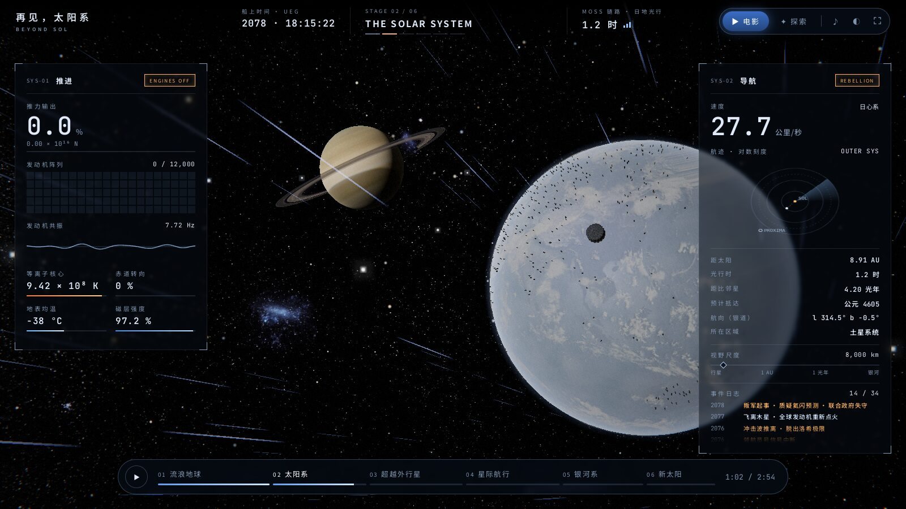
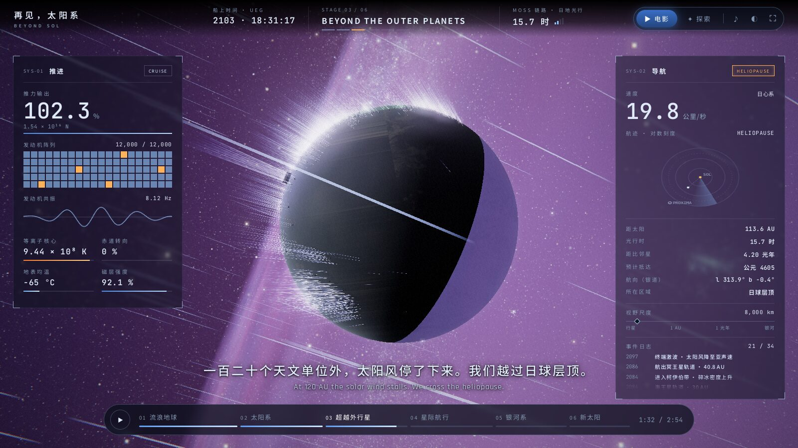
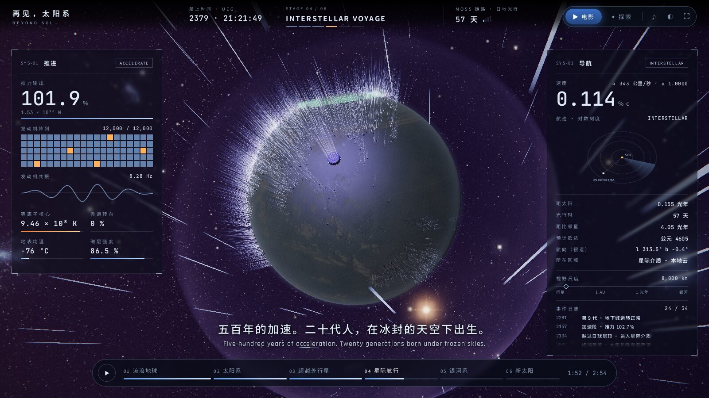
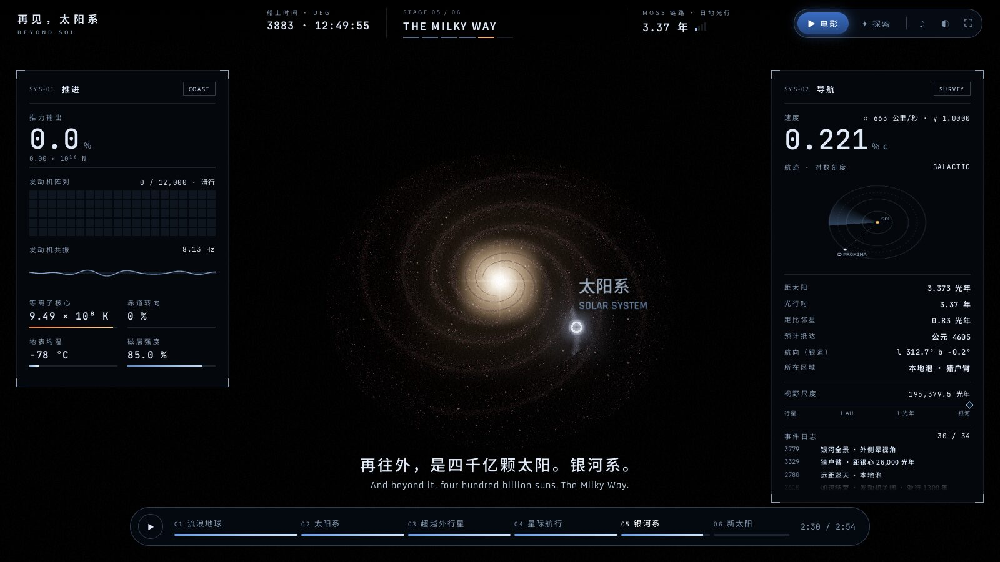
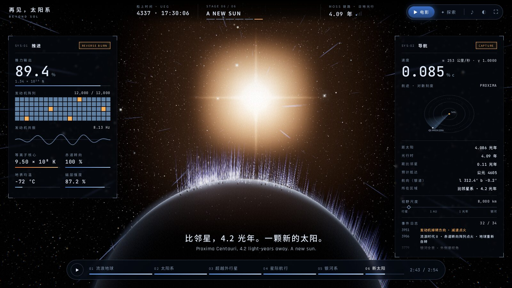

# 再见，太阳系 · Beyond Sol

一部向《流浪地球》致敬的 **three.js 实时交互宇宙旅程**（非官方同人作品）。
约 2 分 54 秒、六个章节：从一万两千台行星发动机点火，到穿越太阳系、日球层顶、星际空间，拉远到整个银河系，最后抵达比邻星（4.2 光年）的新太阳。

画面全部实时渲染：GLSL 着色器 + 后期泛光，配乐由 Web Audio 实时合成，没有一帧预渲染视频。

> **本项目基于 [oxomkbk/earth-migration](https://github.com/oxomkbk/earth-migration)（地球迁移计划 · The Earth Migration Project，MIT 许可，Copyright (c) 2026 玛卡巴卡）修改而来。** 详见下方「上游项目与修改说明」。

## 截图

以下均为影片模式实时渲染的定格画面（`node tools/shots.mjs`，1600×900）。

| | |
| --- | --- |
|  |  |
| 00:08 · 点火：重型阵列的等离子光柱刺穿大气 | 00:27 · 方舟号国际空间站（2044 年档案） |
|  |  |
| 00:33 · 领航员国际空间站 | 00:47 · 衰老的太阳：耀斑、日珥与日冕物质抛射 |
|  |  |
| 00:56 · 木星危机：领航员号点燃木星 | 01:02 · 土星与冰封的地球 |
|  |  |
| 01:32 · 越过日球层顶（约 120 AU） | 01:52 · 星际航行：五百年的加速 |
|  |  |
| 02:30 · 银河系：太阳在猎户臂 | 02:43 · 新太阳：比邻星，4.2 光年 |

## 上游项目与修改说明

### 上游项目

- 仓库：https://github.com/oxomkbk/earth-migration
- 作者：玛卡巴卡（oxomkbk）
- 许可：MIT License，Copyright (c) 2026 玛卡巴卡
- 简介：基于 three.js r160 的电影级交互式 WebGL 体验，分两部：第一部（`index.html`，行星发动机、赤道转向阵列、太空电梯与一部约 62 秒的影片）和第二部 *Beyond the Wandering Earth*（`beyond.html`，从行星发动机一路拉远到银河系的约 2 分 54 秒影片 + 自由探索）。

本项目以上游第二部的整体构思为基础：六章影片 + 自由探索的结构、地球 / 太阳系 / 银河三层尺度的世界划分、推进与导航仪表盘、MOSS 链路延迟等遥测、事件日志、底部章节条与「影片中滚轮穿越时间」的交互、硬表面拼装建模（kitbash）和生成式配乐的思路。

### 直接沿用或移植的部分

| 本项目文件 | 来源 | 说明 |
| --- | --- | --- |
| `src/fx/triplanar.js` | 上游 `js/fx/triplanar.js` | 无 UV 几何体的三向投影 PBR 着色，移植后适配本项目 |
| 方舟号站体（`src/worlds/earth.js` 内） | 上游同步轨道站 | 站体造型参考上游设计 |
| `public/assets/tex/pbr/` | Poly Haven（上游同样使用） | metal_plate_02、painted_metal_shutter、blue_metal_plate，CC0 |

### 主要改动

- **工程化**：改为 Vite 工程（`npm run dev / build`），three.js 升级到 0.170 并通过 npm 引入；源码重组为 `src/main.js`、`src/story.js`、`src/hud.js`、`src/worlds/*`、`src/fx/*`。
- **剧本与时间线**：按电影时间线（2044 太空电梯危机、2058 全球点火、2075 木星引力危机、2078 太阳氦闪）与原著航程结构（加速 500 年 · 滑行 1300 年 · 减速与泊入）重写章节、字幕和事件日志；发动机数量取原著 12,000 台；比邻星按电影取 4.2 光年，巡航速度 0.221% c，使速度积分与距离一致（`tools/year_check.mjs` 校验）。
- **第一章**：点火从重型阵列向整个半球蔓延；2044 年档案闪回（加蓬外海太空电梯、攀爬舱、方舟号国际空间站）；按电影还原的领航员国际空间站。
- **木星危机（电影版）**：地球被木星引力突增拽向木星，在洛希极限附近被「钉住」并缓慢下沉；木星把地球大气撕扯成烈焰色、随自转拧成脐带状的气流；三道地面发动机喷流射向气流却差一截够不着；领航员号冲进喷流顶端，在两星夹缝中点燃混合气，火焰沿气流烧向木星、引爆木星大气，火焰冲击波扫过地球并把它推开（`src/fx/ignition.js`，镜头 52–60 s）。
- **太阳系**：衰老的太阳（米粒组织、黑子、日珥、日冕物质抛射）、土星环影、冥王星（JPL 轨道根数 + 新视野号贴图）、地球外旋航迹。
- **外太阳系与星际**：终端激波、日球层顶、弓形激波（仅镜头 14 出现）与极光、冰封地球的地下城灯网。
- **银河**：HYG 星表 100 光年内近邻恒星（`src/data/near-stars.js`）、对数尺度连续拉远到 36 万粒子的棒旋银河、太阳定位环。
- **贴图与性能**：8K 贴图改用 KTX2（UASTC + Zstd）并自动回退 JPG；等离子光柱改为单次 draw call 的实例化条带（`src/fx/plumes.js`）。
- **仪表盘与字体**：HUD 重新排版，中文字体按实际文本裁剪子集（`npm run font`）。
- **开发工具**：定格截图、冒烟测试、星表生成、年份一致性检查等 Node 脚本（`tools/`）。

## 运行

需要 Node.js 18 及以上。

```bash
npm install
npm run dev        # 开发模式，自动打开 http://localhost:5173
```

打包成静态网站（可以丢到任何静态托管，或者离线用）：

```bash
npm run build      # 输出到 dist/
npm run preview    # 本地预览打包结果
```

> 推荐桌面版 Chrome / Edge，独立显卡体验最好。首次加载约 110 MB 贴图（8K 贴图走 KTX2；不支持 KTX2 或加 `?ktx2=0` 时约 30 MB）。

## 操作

| 操作 | 作用 |
| --- | --- |
| 空格 | 播放 / 暂停影片 |
| ← / → | 后退 / 前进 5 秒 |
| 影片中滚动鼠标滚轮 | 穿越时间（拖动时间线） |
| 底部章节条 | 点击跳章 |
| F 或右上角「探索」 | 自由探索：拖拽旋转、滚轮缩放、点目的地飞过去 |
| M / ♪ | 声音开关 |
| H / ◐ | 隐藏仪表盘 |
| ⛶ | 全屏 |

调试参数：`?t=秒` 定格到影片某一时刻；`?dpr=1` 降低渲染分辨率（集显卡顿时有用）；`?autoplay` 跳过开始按钮。

## 六个章节

| # | 章节 | 内容 |
| --- | --- | --- |
| 01 | 流浪地球 | 2058 年，点火从重型阵列开始向整个半球蔓延；2044 年档案闪回：加蓬外海的太空电梯，攀爬舱升到同步轨道；方舟号国际空间站（同步轨道船坞，在建，2044 年坠毁）；领航员国际空间站（2048 年起建造，单座，按电影还原） |
| 02 | 太阳系 | 2058—2078：时间压缩下的太阳系俯瞰与地球外旋航迹（原著 15 圈，画 3.5 圈）；衰老的太阳（米粒组织、黑子、日珥、日冕物质抛射）；2075 木星引力危机：地球被木星拽住、困在洛希极限附近（5,000 余座发动机停机），大气被撕成烈焰色气流，领航员号冲进发动机喷流点燃木星，冲击波把地球推开；土星（与地球分开构图，含环影）；冥王星；2078 叛乱与太阳氦闪 |
| 03 | 超越外行星 | 2080—2105，12 → 120 AU（约 20 km/s）：海王星；柯伊伯带冰屑；终端激波（约 87 AU）；越过日球层顶（约 120 AU） |
| 04 | 星际航行 | 2105—2605 加速到 0.221% c（约 663 km/s；原著加速期自飞离木星、约 2077 年起）：冰封的地球与地下城灯网；弓形激波与极光；渐亮的比邻星 |
| 05 | 银河系 | 2605—3905 发动机关闭滑行 1300 年；对数尺度连续拉远：太阳—比邻星航线 → 本地泡 → 猎户臂 → 36 万粒子的棒旋银河 |
| 06 | 新太阳 | 3905—4605：地球重新自转、发动机掉转方向减速并泊入轨道（原著：减速 500 年 + 泊入 100 年；这里合计 700 年），被新恒星照亮 |

### 年代与数据

电影时间线（2044 太空电梯危机、2058 月球坠落危机与全球点火、2075 木星引力危机、2078 太阳氦闪危机）＋ 原著航程结构（加速 500 年 · 滑行 1300 年 · 减速与泊入）。比邻星按电影取 4.2 光年（原著 4.3 光年）；巡航速度取 0.221% c，使速度积分恰好等于 4.2 光年（原著的"光速千分之五"按同样时间表约 9 光年，自相矛盾）。HUD 距离在 66 s 以后由速度 × 年份积分得到，`node tools/year_check.mjs` 检查年份单调、事件年份与速度—距离一致性。发动机数量取原著 12,000 台（电影为一万座行星发动机）。

## 结构

```
index.html              页面外壳与 HUD 布局
src/main.js             渲染器、后期（泛光 + 色差/暗角/颗粒）、导演（世界切换、镜头、转场）、探索模式
src/story.js            剧本：章节、字幕、事件日志、遥测关键帧
src/hud.js              仪表盘：推进 / 导航面板、雷达、波形、日志、章节条、标题卡
src/audio.js            生成式配乐（Web Audio）
src/assets.js           贴图加载（8K 贴图优先 KTX2，不支持时回退 JPG）
src/data/near-stars.js  HYG 星表中 100 光年内的恒星（由 tools/near-stars.mjs 生成）
src/worlds/earth.js     地球世界（1 单位 = 地球半径）：地球着色器、发动机网络、电梯、方舟号、领航员号、行星飞掠、星际特效
src/worlds/solar.js     太阳系世界（艺术化尺度 R = 6·r^0.6）
src/worlds/galaxy.js    银河世界（1 单位 = 1 光年）
src/fx/plumes.js        等离子光柱：沿轴朝向相机的实例化条带，一次 draw call 画上万条
src/fx/kit.js           硬表面拼装建模（舰船、空间站、攀爬舱、桁架）
src/fx/shaders.js       地球、云、大气、行星、光晕等着色器
src/fx/space.js         银河天空、星点、速度流线、冰屑
src/fx/ignition.js      木星危机：脐带气流、发动机喷流、点火、木星大气燃烧、火焰冲击波、镜头抖动
src/fx/triplanar.js     三向投影 PBR（移植自上游 js/fx/triplanar.js）
docs/screenshots/       README 截图
public/assets/          贴图（JPG + 8K 的 KTX2）、basis 转码器、字体
tools/                  开发工具（全部 Node）：截图 shots.mjs、冒烟测试 smoke.mjs、字体子集化 subset-font.mjs、星表生成 near-stars.mjs
tools/fonts/            完整的 Noto Sans SC 可变字重源文件（只供裁剪，不进打包产物）
```

## 开发工具

```bash
npm run font                          # 改过中文文本后重新裁剪 HUD 字体（扫描 src/**/*.js 与 index.html）
npm run smoke                         # 冒烟测试：开始播放、确认时间前进、三个世界的探索目的地全部飞一遍；出错时非 0 退出
node tools/shots.mjs 55,90,160 1280 720   # 定格截图：时间点、宽、高
node tools/near-stars.mjs             # 重新生成近邻星表（自动下载 HYG v4.4）
```

Playwright 启动失败时，先运行 `npx playwright install chromium`，再按提示安装系统依赖（`sudo npx playwright install-deps chromium`）。

### 贴图压缩（KTX2）

`earth_day`、`earth_night`、`earth_clouds`、`jupiter` 四张 8K 贴图另存为 KTX2（UASTC + Zstd，带 mipmap）。浏览器支持任何 GPU 压缩格式时用 KTX2，显存占用约为 JPG 解码后的 1/4–1/8；否则或加载失败时逐张回退 JPG。地址栏加 `?ktx2=0` 可强制 JPG。重新编码用 [basisu](https://github.com/BinomialLLC/basis_universal)：

```bash
basisu -uastc -uastc_level 2 -mipmap -y_flip -srgb   -ktx2 earth_day.jpg   # 颜色贴图（day / night / jupiter）
basisu -uastc -uastc_level 2 -mipmap -y_flip -linear -ktx2 earth_clouds.jpg
```

## 素材来源与授权

- **上游代码**：[oxomkbk/earth-migration](https://github.com/oxomkbk/earth-migration)，MIT License，Copyright (c) 2026 玛卡巴卡。本项目中源自上游的部分继续受其 MIT 许可约束，其版权与许可声明见下方「许可证」
- 行星、太阳、地球昼/夜/云/法线/镜面贴图：Solar System Scope（solarsystemscope.com/textures），CC BY 4.0，经由 Wikimedia Commons 获取
- 银河全景：ESO / S. Brunier，“The Milky Way panorama”，CC BY 4.0
- 冥王星：轨道根数 a 39.48 AU、e 0.2488、i 17.16°、Ω 110.3°、ω 113.8°（JPL 近似值）；贴图 `pluto.jpg` 为新视野号全球彩色拼接图（缩至 2048×1024），NASA/JHUAPL/SwRI，public domain，来源 https://commons.wikimedia.org/wiki/File:Pluto_color_mapmosaic.jpg
- 近邻恒星：HYG 星表 v4.4（David Nash / astronexus，codeberg.org/astronexus/hyg），CC BY-SA 4.0；`src/data/near-stars.js` 为其衍生数据，同样以 CC BY-SA 4.0 提供
- PBR 金属贴图：Poly Haven（metal_plate_02、painted_metal_shutter、blue_metal_plate），CC0
- 字体：Orbitron、Rajdhani、JetBrains Mono、Noto Sans SC（均为 SIL Open Font License 1.1）
- 舰船、空间站、发动机、银河系为程序化生成；配乐为程序实时合成

## 许可证

本项目代码以 MIT License 发布（见 `LICENSE`）。

源自上游的部分保留原版权声明：

```
MIT License

Copyright (c) 2026 玛卡巴卡
https://github.com/oxomkbk/earth-migration

Permission is hereby granted, free of charge, to any person obtaining a copy
of this software and associated documentation files (the "Software"), to deal
in the Software without restriction, including without limitation the rights
to use, copy, modify, merge, publish, distribute, sublicense, and/or sell
copies of the Software, and to permit persons to whom the Software is
furnished to do so, subject to the following conditions:

The above copyright notice and this permission notice shall be included in all
copies or substantial portions of the Software.

THE SOFTWARE IS PROVIDED "AS IS", WITHOUT WARRANTY OF ANY KIND, EXPRESS OR
IMPLIED, INCLUDING BUT NOT LIMITED TO THE WARRANTIES OF MERCHANTABILITY,
FITNESS FOR A PARTICULAR PURPOSE AND NONINFRINGEMENT. IN NO EVENT SHALL THE
AUTHORS OR COPYRIGHT HOLDERS BE LIABLE FOR ANY CLAIM, DAMAGES OR OTHER
LIABILITY, WHETHER IN AN ACTION OF CONTRACT, TORT OR OTHERWISE, ARISING FROM,
OUT OF OR IN CONNECTION WITH THE SOFTWARE OR THE USE OR OTHER DEALINGS IN THE
SOFTWARE.
```

## 声明

本作品是受电影《流浪地球》及刘慈欣同名小说启发的非官方同人创作，与电影出品方、原著及其版权方无关；与上游项目作者亦无隶属关系。
